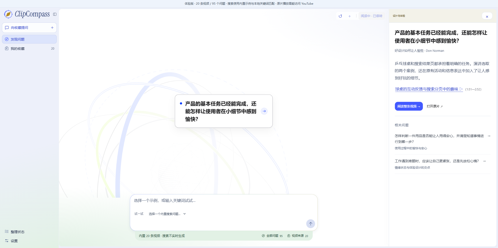

# ClipCompass

让收藏过的视频变成可以按问题进入、读懂并回到原片核对的知识内容。

视频收藏越来越多时，记得“看过相关内容”并不代表能找到具体讲解。ClipCompass 将视频内容整理为问题、分层导读和核心纪要，再把解释与对应的时间片段相连，帮助用户找到值得重新观看的部分。

## 核心流程

1. 从收藏中的问题出发浏览内容，或主动输入一个问题。
2. 先阅读简明解释与覆盖范围，再决定是否展开详细讲解。
3. 打开视频导读或核心纪要，查看内容结构。
4. 回到原视频对应时段核对讲解；资料不足时保留缺口，不用外部知识补成完整答案。



## 产品取舍

- 通过问题组织入口，让收藏内容比标题列表更容易被再次发现。
- 分开呈现简明解释、完整导读与原片片段，适应不同深度的阅读需求。
- 保留视频来源与时间范围；“部分相关”和“充分回答”具有不同含义。
- 发现、收藏浏览和主动搜索沿用同一批内容，减少入口之间的信息断裂。

## 先体验成品

需要 Node.js 24 或以上版本。在仓库根目录运行：

```sh
npm run preview
```

打开 [本地体验](http://127.0.0.1:3203/)。点击轨道中的问题，阅读解释、导读和纪要；切换收藏，选择一个内置搜索问题，或输入关键词查看相关的已存讲解。

成品内置 20 条视频的公开来源信息、95 个问题、导读、核心纪要和 9 个搜索示例。预置结果来自已保存的产品内容，未附带完整原始字幕、音视频文件或评测真值。**自由输入仅做浏览器内的词语匹配，不是实时语义搜索或模型生成**。原片播放依赖访问 YouTube 的网络条件。

## 查看与运行源码

- `product/frontend/`：最终发现页、收藏与阅读/搜索界面的源码。
- `product/library/`、`product/llm/`：本地内容整理、检索、模型连接和 HTTP 服务。
- `product/evaluation/`：现有运行链路实际引用的检索/内容处理辅助代码；不包含评测数据或运行记录。
- `demo/site/`：可直接运行、托管的固定内容成品。
- `demo/scripts/build.mjs`：将最终前端与固定内容适配层构建为静态成品。

源码配置和重建步骤见 [运行说明](docs/RUNNING.md)。

## 当前边界

这是本地个人知识工具原型，没有多人账户或生产服务保证。内容整理、相关性与时间定位依赖字幕质量和模型判断；公开演示不证明实时检索准确率或真实学习收益。本次整理验证了成品页面和固定内容流程，未重新采集字幕、运行模型或验证外部视频播放。

## 发布范围与许可

本仓库是最终产品的独立脱敏快照，私有仓库的提交历史、开发聊天、实验过程、原始评测输出、恢复备份和凭据均不随库发布。`demo/` 内的交互样例属于成品体验数据，不是完整开发记录。

第三方组件、字体和素材的权利属于各自作者，原有许可证和署名随源码保留；公开可见不代表对所有内容统一授予开源或商用许可。作者新增部分暂未另行授予开源许可。
